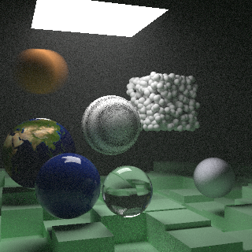
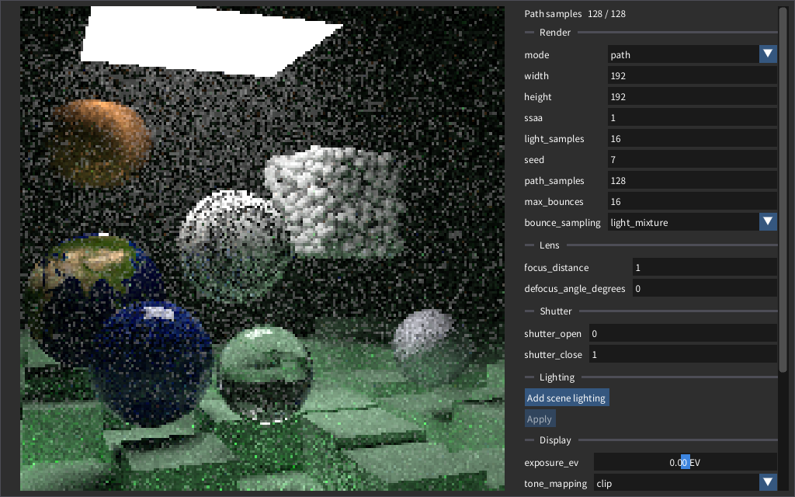

# Formlight Renderer

**Formlight Renderer** 是一个使用 **C++23（命名模块）** 编写的 CPU 渲染器。它在同一套场景数据、相机模型与线性 HDR 图像缓冲之上，统一实现了三种渲染模式：

- **`raster`（软件光栅化）**：glTF 2.0 材质、多套 UV、解析屏幕导数与三线性 Mipmap、MikkTSpace 法线贴图、方向光阴影图（含 3×3 PCF）、逐像素排序透明合成与 2×2 SSAA，另提供基于 Concept 的自定义 Shader 入口。
- **`hybrid`（前向混合阴影）**：复用同一套光栅主可见性，在着色期通过 BVH 发射阴影射线，支持硬阴影、点光源与矩形面光源软阴影。
- **`path`（离线路径追踪）**：基于 `SurfaceBvh` 同时支持三角网格与解析球，覆盖漫反射色溢、混合重要性采样、理想镜面与模糊金属、Fresnel/Snell 玻璃折射、薄透镜景深、快门运动模糊，以及球形均匀参与介质（吸收与各向同性散射）。

命令行程序 `formlight-renderer` 负责离线出图与单像素诊断重放，交互窗口 `formlight-viewer` 复用完全相同的渲染库和 TOML 场景配置。

| 光栅 · glTF 纹理 | 混合 · 矩形灯软阴影 | 路径追踪 · Final Scene |
| --- | --- | --- |
|  |  |  |

### 光栅材质展示


从上到下对照光滑、粗糙和带金属度的材质。第一列的棋盘格在磨砂球后变模糊，最右列还能看到蓝色玻璃的开孔和彩色投影。模型为 Adobe 的 TransmissionTest（CC0）。[机位、灯光与材质说明](docs/scenes.md#磨砂玻璃与彩色投影)

## 交互预览窗口



- **视口导航**：中键拖动环绕，`Shift + 中键` 平移，滚轮缩放。
- **像素诊断与聚焦**：左键点击任意像素，查看命中的实例、材质参数、阴影遮挡与各灯贡献；按 **`F`** 聚焦选中物体。
- **场景读写**：**Open Model** 打开 `.gltf` / `.glb`，**Save Scene As** 将当前机位与已应用设置导出为 TOML。
- **路径追踪交互**：按批次渐进累积，**Path samples** 实时显示进度；调高 `path_samples` 后点击 **Apply** 可直接从当前画面无损续算，**Cancel / Resume** 可随时暂停于完整批次并继续。
- **即时显示调节**：调整曝光（EV）或切换 Clip / Reinhard 色调映射时直接复用内存中的线性 HDR 图像，不中断路径累积。

## 构建与运行

目标平台为 **Windows x64**，工具链使用 **CMake 4.5+**、**Ninja**、**LLVM `clang-cl`**、支持 `import std;` 的 **MSVC 标准库与 Windows SDK**，以及独立克隆并完成 bootstrap 的 **vcpkg**。

在 PowerShell 中进入仓库根目录，将第一行改为本机 vcpkg 路径后运行以下命令。

```powershell
$env:VCPKG_ROOT = 'D:\vcpkg'
cmake --preset release -DFORMLIGHT_BUILD_VIEWER=ON
cmake --build --preset release --parallel 4
ctest --preset release --output-on-failure

.\build\release\formlight-renderer.exe --preset many_balls --output build/release/many-balls.png
.\build\release\formlight-viewer.exe --scene scenes/path/final-scene.toml
```

- 仅构建无窗口 CLI 时，将 `FORMLIGHT_BUILD_VIEWER` 设为 `OFF`。
- 本机路径与共享缓存建议放进 Git 忽略的 `CMakeUserPresets.json`，详见[构建目录与本机配置](docs/build.md)。

## 文档导航

| 文档 | 内容概览 |
| --- | --- |
| [构建目录与本机配置](docs/build.md) | `CMakeUserPresets.json` 缓存收口、无窗口 CLI 独立构建与运行时依赖说明 |
| [场景与使用示例](docs/scenes.md) | CLI 参数、全部内置场景索引、Cornell / Many Balls / Final Scene 实验，以及 TOML 与 glTF 约定 |
| [渲染方程与采样](docs/rendering.md) | 三种模式的光照与采样数学、矩形灯 Halton 收敛、混合重要性采样、介质传输与同机位对比 |
| [源码调用路径](docs/call-paths.md) | CMake 模块分层、CLI 与 Viewer 线程调用链、场景 slot/借用约定与自定义 Shader 入口 |
| [方盒阴影实验](docs/box-shadows.md) | 阴影图、方向光射线与矩形灯软阴影的几何基准、像素重放和半影截线误差测量 |

---

[MIT 许可证](LICENSE) · [素材与字体许可](assets/README.md)
