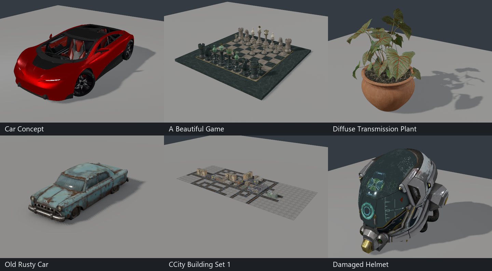
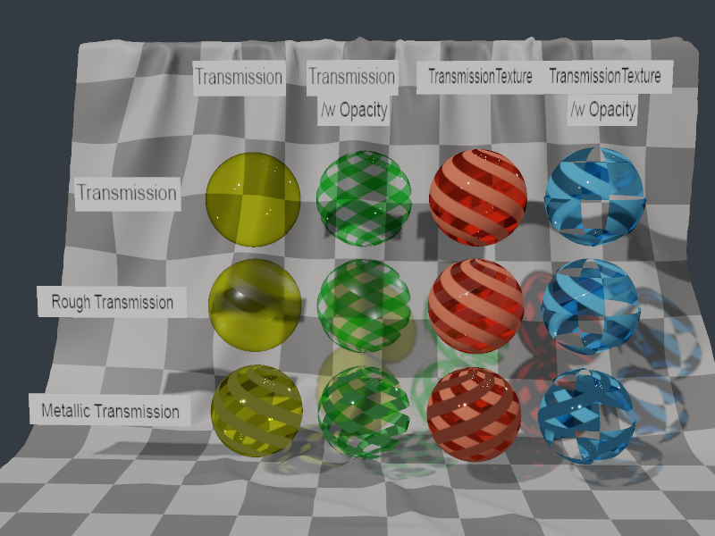
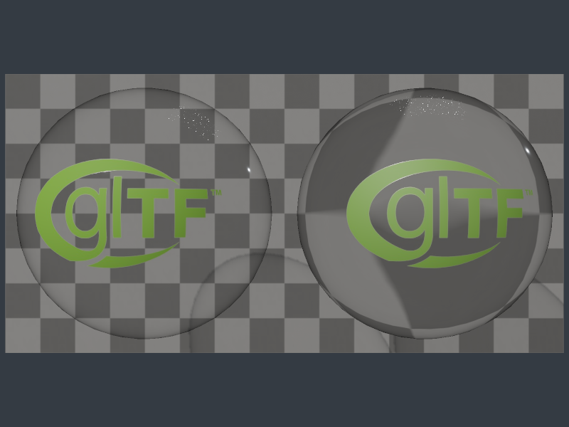
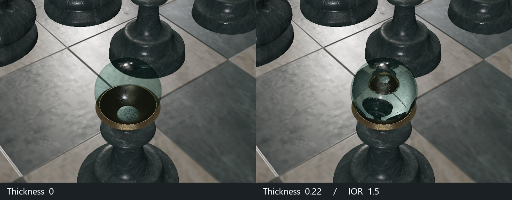
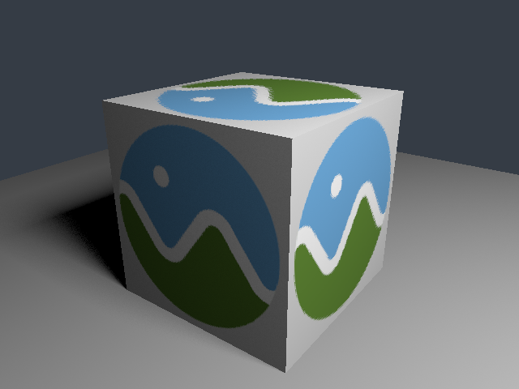

# Formlight Renderer

**Formlight Renderer** 是一个使用 **C++23（命名模块）** 编写的 CPU 渲染器。它在同一套场景数据、相机模型与线性 HDR 图像缓冲之上，统一实现了三种渲染模式：

- **`raster`（软件光栅化）**：glTF 2.0 材质、多套 UV、解析屏幕导数与三线性 Mipmap、MikkTSpace 法线贴图、方向光阴影图（含 3×3 PCF）、`KHR_materials_transmission` / `ior` / `volume` 玻璃透射折射、逐像素排序透明合成与 2×2 SSAA，另提供基于 Concept 的自定义 Shader 入口。
- **`hybrid`（前向混合阴影）**：复用同一套光栅主可见性，在着色期经 BVH 发射阴影射线，支持硬阴影、点光源、矩形面光源软阴影与彩色透射阴影。
- **`path`（离线路径追踪）**：基于 `SurfaceBvh` 同时支持三角网格与解析球，覆盖漫反射色溢、混合重要性采样、理想镜面与模糊金属、Fresnel/Snell 玻璃折射、薄透镜景深、快门运动模糊与球形均匀参与介质。

命令行程序 `formlight-renderer` 负责离线出图与单像素诊断重放，交互窗口 `formlight-viewer` 复用完全相同的渲染库和 TOML 场景配置。

## 模型预览



六个模型使用同一套通用预览灯组渲染：透过概念车的挡风玻璃可以看到红色座椅，黑棋兵的球顶透出折射偏移后的棋盘格。[车窗与棋兵前后对照](docs/scenes.md#六模型同机位验收) · [展示图素材署名](assets/README.md#gallery-image-credits)

### 透射、折射与体积厚度

| TransmissionTest · 十二个材质球 | CompareIor · 两个 glTF 标志球 |
| --- | --- |
|  |  |
| 第一列自上而下可观察磨砂黄球背后逐渐模糊的棋盘格；最右列蓝球同时叠加了透射条纹与镂空开孔。[十二球排列与机位](docs/scenes.md#磨砂玻璃与彩色投影) | 左球为零厚度薄壳（默认 IOR `1.5`）；右球带厚度且 IOR 为 `2.42`，折射位移使背景棋盘格明显放大。[双球材质与机位](docs/scenes.md#两个-gltf-标志球) |



两张棋兵近景仅改变玻璃厚度（左 `0`，右模型原始厚度 `0.22`）：沿球顶左上方格线观察，左图笔直穿过球面，右图向球内弯折，两侧均保留原材质的青绿色。[机位与重拍参数](docs/scenes.md#棋兵的厚玻璃) · [透射、折射与吸收公式](docs/rendering.md#gltf-玻璃的透射与折射)

### 三种渲染模式

| 光栅 · glTF 纹理 | 混合 · 矩形灯软阴影 | 路径追踪 · Final Scene |
| --- | --- | --- |
|  |  |  |

## 交互预览窗口


- **视口导航**：中键拖动环绕，`Shift + 中键` 平移，滚轮缩放。
- **像素诊断与聚焦**：左键点击任意像素，查看命中的实例、材质参数、阴影遮挡与各灯贡献；按 **`F`** 聚焦选中物体。
- **场景读写**：**Open Model** 打开 `.gltf` / `.glb`，**Save Scene As** 将当前机位与已应用设置导出为 TOML。
- **路径追踪交互**：按批次渐进累积，**Path samples** 实时显示进度；调高 `path_samples` 后点击 **Apply** 可直接从当前画面无损续算，**Cancel / Resume** 可随时暂停于完整批次并继续。
- **即时显示调节**：调整曝光（EV）或切换 Clip / Reinhard 色调映射时直接复用内存中的线性 HDR 图像，不中断路径累积。

## 构建与运行

目标平台为 **Windows x64**，工具链使用 **CMake 4.5+**、**Ninja**、**LLVM `clang-cl`**、支持 `import std;` 的 **MSVC 标准库与 Windows SDK**，以及独立克隆并完成 bootstrap 的 **vcpkg**。

在 PowerShell 中进入仓库根目录，将第一行改为本机 vcpkg 路径后运行以下命令。

```powershell
$env:VCPKG_ROOT = 'D:\vcpkg'
cmake --preset release -DFORMLIGHT_BUILD_VIEWER=ON
cmake --build --preset release --parallel 4
ctest --preset release --output-on-failure

.\build\release\formlight-renderer.exe --preset many_balls --output build/release/many-balls.png
.\build\release\formlight-viewer.exe --scene scenes/path/final-scene.toml
```

- 仅构建无窗口 CLI 时，将 `FORMLIGHT_BUILD_VIEWER` 设为 `OFF`。
- 本机路径与共享缓存建议放进 Git 忽略的 `CMakeUserPresets.json`，详见[构建目录与本机配置](docs/build.md)。

## 文档导航

| 文档 | 内容概览 |
| --- | --- |
| [构建目录与本机配置](docs/build.md) | `CMakeUserPresets.json` 缓存收口、无窗口 CLI 独立构建与运行时依赖说明 |
| [场景与使用示例](docs/scenes.md) | CLI 参数、全部内置场景索引、Cornell / Many Balls / Final Scene 与 glTF 玻璃展示验收 |
| [渲染方程与采样](docs/rendering.md) | 三种模式的光照与采样数学、glTF 透射/折射/吸收、矩形灯 Halton 收敛、介质传输与同机位对比 |
| [源码调用路径](docs/call-paths.md) | CMake 模块分层、光栅/透射合成与路径调用链、Viewer 双线程协作与自定义 Shader 入口 |
| [方盒阴影实验](docs/box-shadows.md) | 阴影图、方向光射线与矩形灯软阴影的几何基准、像素重放和半影截线误差测量 |

---

[MIT 许可证](LICENSE) · [素材与字体许可](assets/README.md)
