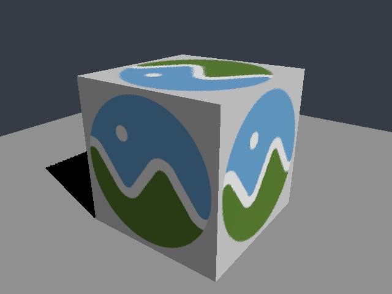
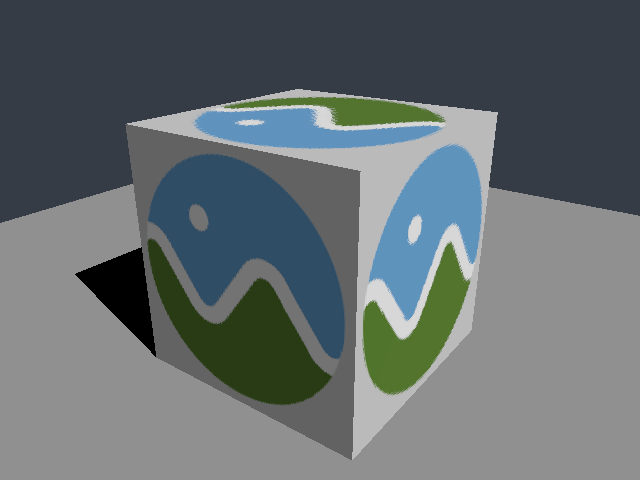

# 方盒的硬阴影与软阴影

三幅图共用 `BoxTextured.glb`、灰色地面、640×480 的相机和单中心采样。前两幅使用同一盏白色方向光，朝向灯的向量为 (3, 3, 0.75)，PCF 关闭。第三幅将光源换成中心位于 (3, 3, 0.75) 的水平矩形灯，边长 1.5，总功率 240，每像素采样灯面 64 次，种子为 7。方盒左侧地面的阴影边缘最容易观察。[方向光配置](../scenes/lighting/box-directional.toml) · [面光源配置](../scenes/lighting/box-area-light.toml)

| 方向光 · 阴影图 | 方向光 · 阴影射线 | 矩形灯 · 阴影射线 |
| --- | --- | --- |
|  |  |  |

## 硬阴影的几何参照

方盒在世界坐标下覆盖三个轴的 [−0.5, 0.5]。从每个像素中心发相机射线，分别和三个轴的区间求交，即可独立判定方盒轮廓。在这组机位上，共有 102 105 个像素命中方盒；用同机位关闭地面的渲染核对，轮廓逐像素吻合。面内可用像素诊断重放，例如 (407, 246) 位于 +X 面，(200, 260) 位于 +Z 面，两处的蓝色纹素均给出线性底色 (0.149960, 0.417885, 0.737911)。另有正视机位的回归直接核对透视 UV 和纹理上下方向。[方盒几何测试](../tests/gltf_geometry_test.cpp)

画面中另有 111 638 个像素首先命中地面。从这些地面点沿方向光向量与同一方盒求交，预期有 3 905 个处于阴影中，射线阴影全部吻合。1024×1024 阴影图与射线图的最终 PNG 有 91 个像素不同，均在地面阴影轮廓的一个像素邻域内。

## 重放三个地面像素

三个像素均命中地面实例 2、图元 0，材质槽为 2。表中的遮挡数是被方盒挡住的灯面样本数。每个可见样本对直接光的贡献还取决于入射方向、距离和 BRDF，最终颜色由这些线性 RGB 贡献累加得到。

| 矩形灯下的位置 | 像素 (x, y) | 遮挡数 / 64 | 方向光线性 R（两种方法相同） | 矩形灯线性 R | 矩形灯 PNG 灰度 |
| --- | --- | ---: | ---: | ---: | ---: |
| 本影 | (130, 282) | 64 | 0 | 0 | 0 |
| 半影 | (85, 310) | 35 | 0.278577 | 0.064517 | 72 |
| 亮区 | (85, 395) | 0 | 0.277794 | 0.197830 | 123 |

把地面点到各灯面样本的线段与方盒求交，192 次判定与诊断报告一致。将报告列出的贡献按通道求和，与像素线性 RGB 的最大绝对差小于 3×10⁻⁹；再经 sRGB 编码可得到表中的 PNG 灰度。

## 灯面尺寸、离地高度与采样误差

沿画面第 85 列，从第 270 行扫到第 400 行。用 1 024 个灯面样本估计遮挡比例，统计落在 10% 到 90% 之间的地面像素。相机、地面、灯中心与总功率固定，分别改变方盒离地高度和灯的边长。这里的像素数衡量这条截线上的过渡宽度。

| 方盒离地高度 | 边长 0.5 | 边长 1.5 | 边长 1.5，4 样本 RMS 误差 | 边长 1.5，64 样本 RMS 误差 |
| --- | ---: | ---: | ---: | ---: |
| 贴地 | 14 像素 | 63 像素 | 0.018162 | 0.002155 |
| 0.25 | 14 像素 | 70 像素 | 0.019509 | 0.002511 |

这条截线上，扩大灯面在两种高度下都拓宽了半影；抬高方盒后，大灯的过渡又增加了 7 个像素。误差取 131 个地面像素的线性 R 均方根差，4 和 64 样本使用种子 7，参照使用 1 024 样本和独立种子 23。[半影截线测试](../tests/box_penumbra_test.cpp)

## 从仓库根目录复现

```powershell
$renderer = ".\build\release\formlight-renderer.exe"
& $renderer --scene scenes/lighting/box-directional.toml --mode raster --output build/release/box-shadow-map.png
& $renderer --scene scenes/lighting/box-directional.toml --mode hybrid --output build/release/box-shadow-ray.png
& $renderer --scene scenes/lighting/box-area-light.toml --output build/release/box-shadow-area.png
& $renderer --scene scenes/lighting/box-area-light.toml --pixel 85 310
ctest --test-dir build/release -V -R '^box_penumbra$'
```

方盒与标志的来源、作者和许可见[素材说明](../assets/README.md)。
