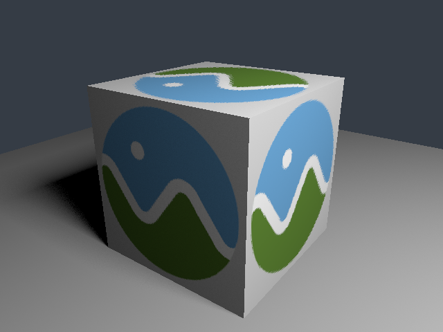

# 方盒的硬阴影与软阴影

本实验在同一机位下对比三种阴影生成方式：**方向光阴影图（`raster`）**、**方向光阴影射线（`hybrid`）**与**矩形面光源软阴影（`hybrid`）**，重点观察方盒左侧地面的阴影过渡。

三幅图共用 `BoxTextured.glb`、中性灰地面、`640×480` 相机与单中心采样：
- **方向光（前两幅）**：白色方向光，朝向光源的向量为 `(3, 3, 0.75)`，关闭 PCF。[方向光配置](../scenes/lighting/box-directional.toml)
- **矩形面光源（第三幅）**：中心位于 `(3, 3, 0.75)` 的水平矩形灯，边长 `1.5`，总功率 `240`，每像素采样灯面 `64` 次，种子 `7`。[面光源配置](../scenes/lighting/box-area-light.toml)

| 方向光 · 阴影图 | 方向光 · 阴影射线 | 矩形灯 · 阴影射线 |
| --- | --- | --- |
|  |  |  |

## 1. 硬阴影的几何解析参照

方盒在世界空间下严格覆盖三轴区间 $[-0.5, 0.5]$，因此可以直接用解析射线求交验证轮廓与阴影：

- **方盒轮廓与底色**：从每个像素中心发射相机射线做轴对齐盒求交，共命中 **102,105** 个像素；与关闭地面后的渲染逐像素吻合。面内像素可通过诊断重放核对，例如 `(407, 246)`（`+X` 面）与 `(200, 260)`（`+Z` 面）两处蓝色纹素的线性底色均为 `(0.149960, 0.417885, 0.737911)`；另有正视机位回归检查透视 UV 与贴图上下朝向。[方盒几何测试](../tests/gltf_geometry_test.cpp)
- **地面阴影射线**：画面另有 **111,638** 个像素首命中地面。从这些地面点沿方向光向量与解析方盒求交，预期 **3,905** 个像素处于阴影中，与射线阴影结果全部吻合。
- **阴影图与射线差异**：`1024×1024` 阴影图与射线阴影的最终 PNG 仅有 **91** 个像素不同，全部集中在地面阴影轮廓的 1 像素邻域内。

## 2. 重放三个典型地面像素

在本影、半影和亮区各取一个像素做诊断重放。三者均命中地面**实例 2、图元 0、材质槽 2**。表中“遮挡数”为 64 个灯面采样点中被方盒挡住的数量；其余可见样本按入射方向、距离和 BRDF 累加得到最终线性颜色（采样公式见[矩形面光源与 Halton 采样](rendering.md#2-矩形面光源可见性与移位-halton-采样)）：

| 区域 | 像素 `(x, y)` | 遮挡数 / 64 | 方向光线性 R（两法一致） | 矩形灯线性 R | 矩形灯 PNG 灰度 |
| --- | --- | ---: | ---: | ---: | ---: |
| 本影 | `(130, 282)` | 64 | `0` | `0` | 0 |
| 半影 | `(85, 310)` | 35 | `0.278577` | `0.064517` | 72 |
| 亮区 | `(85, 395)` | 0 | `0.277794` | `0.197830` | 123 |

用解析方盒独立校验三个像素的全部 `3 × 64 = 192` 条灯面线段，遮挡判定与诊断报告完全一致；将报告列出的逐样本贡献按通道求和，与像素线性 RGB 的最大绝对误差小于 $3 \times 10^{-9}$，再经 sRGB 编码即得表中 PNG 灰度。

## 3. 灯面尺寸、离地高度与半影宽度

固定相机、地面、灯中心与总功率，沿画面第 `85` 列（第 `270` 行至第 `400` 行，共 131 个地面像素）扫描，用 `1,024` 个灯面样本统计遮挡比例落在 **10%–90%** 之间的像素数作为半影过渡宽度：

| 方盒离地高度 | 边长 `0.5` 半影宽 | 边长 `1.5` 半影宽 | 边长 `1.5`（4 样本 RMS 误差） | 边长 `1.5`（64 样本 RMS 误差） |
| --- | ---: | ---: | ---: | ---: |
| 贴地（`0`） | 14 像素 | 63 像素 | `0.018162` | `0.002155` |
| 抬高（`0.25`） | 14 像素 | 70 像素 | `0.019509` | `0.002511` |

- 增大灯面尺寸在两种高度下均显著拓宽了半影；将方盒抬离地面后，大灯面的过渡宽度进一步增加 7 个像素。
- RMS 误差在这 131 个地面像素的线性 R 通道上计算，4 与 64 样本使用种子 `7`，参照值使用独立种子 `23` 的 `1,024` 样本。[半影截线测试](../tests/box_penumbra_test.cpp)

## 4. 复现命令

在仓库根目录执行：

```powershell
$renderer = ".\build\release\formlight-renderer.exe"
& $renderer --scene scenes/lighting/box-directional.toml --mode raster --output build/release/box-shadow-map.png
& $renderer --scene scenes/lighting/box-directional.toml --mode hybrid --output build/release/box-shadow-ray.png
& $renderer --scene scenes/lighting/box-area-light.toml --output build/release/box-shadow-area.png
& $renderer --scene scenes/lighting/box-area-light.toml --pixel 85 310
ctest --test-dir build/release -V -R '^box_penumbra$'
```

方盒与标志的来源、作者与许可见[素材说明](../assets/README.md)。
