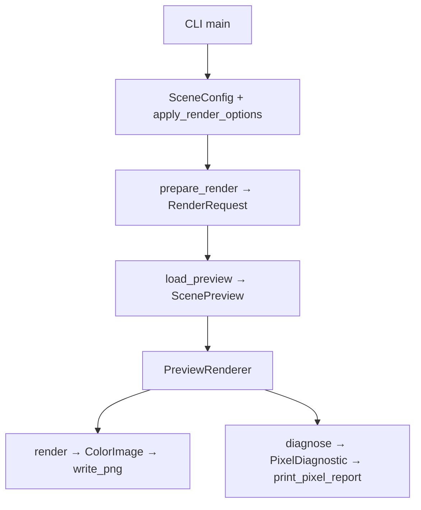

# 源码调用路径

如果要顺着代码跟一次完整渲染，推荐先跑：

```powershell
.\build\release\formlight-renderer.exe --scene scenes/lighting/color-bleed-room.toml --pixel 48 89
```

同一个像素既可以经光栅器选面，也可以经 BVH 射线求交。下面的所有函数名与模块路径均可直接在源码中搜索定位；相关数学公式与数值对照见[渲染方程与采样](rendering.md)。

## 1. 模块与静态库分层

项目全部采用 C++23 命名模块（`.cppm` 放导出接口，较长实现拆进同模块 `.cpp`），[CMakeLists.txt](../CMakeLists.txt) 将目标按职责分为五层：

| CMake 目标 | 职责 | 关键源码位置 |
| --- | --- | --- |
| `formlight_renderer_core` | 几何、相机、线性图像、纹理采样、配置校验、光栅化与自定义 Shader、BVH、采样与介质 | `src/*.cppm`、`src/raster/`、`src/ray/`、`src/lighting/`、`src/path/`、`src/config/` |
| `formlight_io` | PNG/JPEG 编解码、TOML 场景读写与安全写出 | `src/io/image_codec.*`、`src/config/scene_toml.*` |
| `formlight_gltf` | glTF 导入（fastgltf + MikkTSpace）、路径积分器、前向混合预览与 `PathFrame` 分批累积 | `src/io/gltf*`、`src/path/integrator.cppm`、`src/preview*` |
| `formlight-renderer` / `custom_shader` | 离线 CLI 与单像素诊断报告 / 可编程 Shader 独立示例 | `src/main.cpp`、`src/cli/`、`examples/custom_shader.cpp` |
| `formlight-viewer`（可选） | 后台线程会话管理（`formlight_viewer_session`）与 SDL3 + ImGui 窗口（`formlight_viewer_window`） | `src/viewer/` |

## 2. CLI 如何得到一帧图像或诊断报告



1. **组装配置（`SceneConfig`）**：`main` 根据入口分别调用 `load_scene_config`（`--scene`）、`preset_config`（`--preset`）或直接填模型路径（`--render`）；`apply_render_options` 仅覆盖命令行显式给出的字段，并返回输出文件或待诊断像素。`--inspect` 走最短路径，以 `GltfContent::Geometry` 加载后直接统计网格与实例数。[CLI 入口](../src/main.cpp) · [参数覆盖](../src/cli/render_options.cppm)
2. **校验并冻结快照（`RenderRequest`）**：`prepare_render` 校验分辨率、材质与灯光组合（例如带阴影的方向光按模式转为阴影图或射线查询）。`many_balls` 在此阶段直接生成 484 个解析球，`final_scene` 则把布局种子交给下一阶段。[配置与校验](../src/config/scene_config.cppm) · [预设](../src/config/presets.cpp) · [Many Balls 生成](../src/config/many_balls.cpp)
3. **加载场景资产（`ScenePreview`）**：`load_preview` 导入 glTF 或创建空场景，依次挂载材质覆盖、采样目标、`final_scene` 程序几何、解析球、参与介质与可选地面；随后计算包围盒与相机裁剪深度，返回持有 `GltfScene` 本体和 `PreviewView` 的 `ScenePreview`。[场景准备](../src/preview.cppm) · [Final Scene 几何](../src/preview/final_scene.cpp)
4. **构建渲染器并执行（`PreviewRenderer`）**：`PreviewRenderer` 借用 `GltfScene`，按模式准备阴影图或 BVH / `PathIntegrator`。出图调用 `render` 并经 `write_png` 编码输出；`--pixel` 调用 `diagnose_pixel` → `PreviewRenderer::diagnose` → `print_pixel_report`。[模式配置](../src/preview/shading.cpp) · [PNG 写出](../src/io/image_codec.cpp) · [诊断打印](../src/cli/pixel_report.cpp)

## 3. 场景里的 ID、slot 与借用生命周期

在 `GltfScene::load` 中，fastgltf 完成解析后，代码从默认场景根节点深度遍历并合成世界变换。多个节点可共享同一网格，也允许存在纯变换父节点。容器内部用连续数组存资源、用 `slot`（数组下标）做映射去重：[加载实现](../src/io/gltf.cpp) · [资源容器](../src/io/gltf.cppm)

| 映射表 | 键 → 值 | 作用 |
| --- | --- | --- |
| 加载期 `mesh_slots` | glTF mesh 索引 → `meshes_` 槽位 | `std::optional` 为空表示尚未导入；首次遇到时调用 `read_mesh` 展开三角形，后续节点直接共享同一份几何 |
| `node_instance_slots_` | glTF 节点编号 → 可选 `instances_` 槽位 | `InstanceId` 沿用节点编号，而 `instances_` 紧凑存储实际网格实例；拾取或标记采样目标时由此反查 |
| `materials_` | 三角形 `material_index` → 已加载材质 | 槽 `0` 留给默认材质，glTF 材质 `i` 对应槽 `i + 1`（TOML 覆盖仍填写原索引 `i`） |

**借用约定**：
- `MeshInstance` 通过 `std::span<const Triangle>` 只读借用 `meshes_`；`SurfaceId` 用 `(InstanceId, PrimitiveId)` 唯一标识一次命中，即使多个实例共享同一网格也能准确区分。
- `SurfaceBvh` 在世界坐标下建包围盒，在叶节点将射线变换到实例局部坐标求交；解析球直接按 `ray.time` 求交。命中结果 `SurfacePoint` 以变体区分三角形重心坐标与球面坐标。
- 只要 `PreviewRenderer`、`SurfaceBvh` 或未完成的 `PathFrame` 仍存活，它们所借用的 `GltfScene` 必须保持有效且地址稳定。[实例与变换](../src/mesh_instance.cppm) · [命中与射线起点](../src/ray_query.cppm) · [BVH 建树与遍历](../src/ray/bvh.cpp)

## 4. 光栅与混合渲染路径

```text
PreviewRenderer::render
└─ render_sample_grid
   ├─ rasterize_visibility
   │  ├─ RasterTriangle::prepare → for_each_clipped → clip_and_project
   │  ├─ Solid（无透射的 OPAQUE / MASK）：piece.rasterize → for_each_hit → keep_nearest
   │  └─ Layer（薄透射 / BLEND）：piece.for_each_hit → 收集实体前的片元到 LayerRows
   ├─ oneTBB 按行并行着色：
   │  ├─ shade → surface_material / shading_normal → shade_light
   │  │  ├─ 方向光：raster 查 DirectionalShadowMap（含 PCF）；hybrid 查 TriangleBvh
   │  │  ├─ 点光源：距离衰减 + 射线遮挡
   │  │  └─ 矩形灯：AreaLighting::evaluate
   │  └─ composite_layers（按像素从远到近线性混合透明层）
   └─ SSAA resolve（ssaa == 2 时 2×2 子像素在线性空间求平均）
```

- **裁剪、覆盖与精确导数**：`clip_and_project` 在相机空间裁剪近远平面，并让每个裁剪新顶点保留原三角形的重心权重；`ScreenTriangle` 按像素中心与 top-left 规则测试覆盖；`RasterTriangle::interpolate` 用逆视深恢复透视校正权重与解析屏幕导数，因此多套 UV、Mipmap 与法线贴图都能直接从原始三角形重建。[裁剪](../src/raster/clipping.cpp) · [覆盖](../src/raster/coverage.cppm) · [插值与导数](../src/raster/raster.cppm)
- **透明合成与诊断复现**：先着色最近的写深度表面，再从远到近处理可见的薄透射与 `BLEND` 片元。每层 `shade` 都能读取同一子样本后方已合成的线性颜色；薄玻璃按底色与 Fresnel 衰减透射光并保留镜面高光，最后应用本层的 alpha 覆盖。拾取在 `diagnose_sample` 中重放同一顺序，报告最前方被覆盖的表面及透过它的背景贡献。[帧合成与诊断](../src/preview/compositing.cpp) · [着色与光照](../src/preview/shading.cpp)
- **矩形灯合流点**：在色溢房间里，`hybrid` 与 `path` 都会在 `AreaLighting::evaluate` 会合——经 `sample_area_light → integrate_rectangle_samples → evaluate_finite_light_sample` 逐个求值 Halton 灯面点。`SurfaceRayOrigin::to` 沿几何法线偏移起点并把灯面点放在射线参数 `t = 1` 处；整图渲染调用 `occluded`（遇阻即返回），像素诊断则改调 `intersect_surface` 以报告具体遮挡图元。[矩形灯与遮挡查询](../src/lighting/direct_lighting.cppm)

### 独立入口：可编程自定义 Shader

导入 `formlight.shader` 后可直接调用 `render_shader(camera, instances, range, shader)`：
- `shader.vertex` 返回局部位置和自定义 `Varying`，管线复用 `for_each_clipped` 做裁剪与投影，且裁剪器本身完全不依赖 `Varying` 类型；
- 片元阶段用恢复出的透视校正权重对原三个顶点的 `Varying` 做线性组合，传入 `shader.fragment`；
- `fragment` 返回 `std::optional<LinearColor>`，有值则同时写入颜色与深度，返回 `std::nullopt` 即丢弃片元。

运行示例可查看跨近平面渐变三角形与被 `discard` 的镂空条纹：

```powershell
.\build\release\custom_shader.exe build/release/custom-shader.png
```

[Shader 接口](../src/raster/shader.cppm) · [完整示例](../examples/custom_shader.cpp)

## 5. 路径追踪与分批累积

```text
PreviewRenderer::render → PathFrame::render_batch（8×8 tile 并行）
└─ trace_primary → trace_camera_ray → PathIntegrator::accumulate
   ├─ SurfaceBvh::intersect_surface（求最近表面）
   ├─ sample_free_flight（存在介质时，与最近表面竞争碰撞）
   ├─ surface_radiance / medium_direct_light（首事件直接项）
   └─ trace_bounces → sample_bounce → 迭代追踪下一跳（表面或介质顶点）
```

- **相机采样与区间换算**：`trace_primary` 按子像素坐标与种子派生稳定采样键，并按需抽薄透镜光圈与快门时刻；`trace_camera_ray` 将相机视空间裁剪深度转换为射线参数开区间，再交给 `PathIntegrator::accumulate`。
- **路径迭代断点**：追踪镜面/金属/玻璃反射折射可从 `specular_bounce` 下断点；排查发光网格或玻璃球采样概率可从 `DirectionTargets::density` 下断点。[相机与分批调度](../src/preview/path_frame.cpp) · [路径积分器](../src/path/integrator.cppm) · [采样目标](../src/path/target_sampling.cppm)
- **分批原子性**：`PathFrame` 保存已完成样本数与各子像素的 `RayRadianceSum`。每批渲染都在私有副本 `next` 上追加下一段连续样本，整批完成后才 `swap` 发布，中途取消不会污染已有画面。CLI 循环批次直至达到目标值，`diagnose` 则直接调用 `trace_primary` 重放 `[0, samples)` 前缀。[分批累积回归](../tests/path_frame_test.cpp)

## 6. Viewer 的双线程协作

| 线程 | 调用链与职责 |
| --- | --- |
| **主线程（UI）** | `ViewerWindow::poll / draw → update_image → ViewerDocument::update → ViewerSession::update`；收到新发布的 `ColorImage` 后，经 `upload` 按 SDL 返回行距写入 RGBA32 流式纹理 |
| **后台线程（`PreviewJob`）** | `ViewerSession::schedule_render` 派发 `PathFrame::render_batch`（路径模式，每批 8 样本）或 `PreviewRenderer::render`（光栅/混合）；左键拾取另起独立任务调用 `renderer.diagnose` |

核心生命周期与状态约定：
- **所有权层级**：`ViewerWindow` 拥有 `ViewerDocument`，`ViewerDocument` 拥有 `ViewerSession`，其内部的 `ViewerScene` 为借用它的工作线程提供稳定地址；析构时渲染与拾取线程先 `cancel` 并 join，之后才释放场景与窗口资源。
- **修订号与续算**：每次移动相机或改动设置都会递增 `requested_`，后台返回时仅发布与当前修订号匹配的路径批次。只调高 `path_samples` 会沿用已有 `PathFrame` 续算（例如从 19/35 依次发布 27/35、35/35）；只调曝光或色调映射直接重显当前线性 HDR 帧；点击 **Cancel** 保留屏幕上已完成的完整批次，点击 **Resume** 从断点继续。[窗口入口](../src/viewer/main.cpp) · [会话调度](../src/viewer/session.cpp) · [状态与任务定义](../src/viewer/session.cppm) · [绘制与纹理上传](../src/viewer/window.cppm)

在启用 Viewer 的构建中可运行以下回归，分别验证渐进续算/拾取，以及 CLI PNG 与 SDL 场景纹理在 Clip、降一档曝光和 Reinhard 下的逐像素 RGB8 一致性：

```powershell
ctest --preset release-local -R "viewer_path_progress|viewer_display_rgb8" -V
```

[续算与拾取回归](../tests/viewer_path_progress_test.cpp) · [显示一致性回归](../tests/viewer_display_test.cpp)
