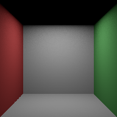
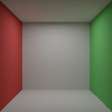

# 渲染方程与采样

以方盒软阴影场景为例：半影中的像素 `(85, 310)`，线性 RGB 为 `(0.06451683, 0.06451683, 0.06451683)`。要解释这个数值，需要回答两个问题——**相机先看到了哪一块表面？到达该表面的光从哪里来？** 在该像素向矩形灯面发出的 64 条线段中，有 35 条被方盒遮挡；其余 29 条各自贡献多少能量，则取决于距离、入射角与地面材质。[方盒阴影实验](box-shadows.md)

## 1. 表面的渲染方程与三种模式

对不透明反射表面，记命中点为 $x$、法线为 $n$、指向相机或上一顶点的出射方向为 $\omega_o$。出射辐亮度满足渲染方程：

$$
L_o(x,\omega_o) = L_e(x,\omega_o) + \int_{\Omega^+} f_r(x,\omega_i,\omega_o)\, L_i(x,\omega_i)\, \max(0,\, n \cdot \omega_i)\, \mathrm{d}\omega_i
$$

- $L_e$ 是表面自身发射的辐亮度；
- 积分在法线上半球 $\Omega^+$ 上累加所有入射方向 $\omega_i$ 的贡献；
- BRDF $f_r$ 把沿 $\omega_i$ 到达的微分辐照度转化为朝向 $\omega_o$ 的出射辐亮度。白墙发红，本质是 $L_i$ 中携带了邻近红墙反射过来的光。路径积分器另行采样实体玻璃的反射与折射，以及介质散射。[PBRT 光传输方程](https://pbr-book.org/4ed/Light_Transport_I_Surface_Reflection/The_Light_Transport_Equation)

三种渲染模式共享同一套场景与线性图像，区别在于**主可见性来源**和**光照积分范围**：

| 模式 | 主可见性（第一个命中点） | 光照与着色方式 |
| --- | --- | --- |
| `raster` | 三角形裁剪、投影，按像素中心覆盖和深度选面 | glTF 材质直接着色；方向光支持阴影图（`pcf = true` 时做 3×3 深度过滤） |
| `hybrid` | 复用同一套光栅主可见性 | 着色期经 BVH 发射遮挡射线；矩形面光源对多个灯面采样点求平均 |
| `path` | 相机射线经 `SurfaceBvh` 求最近表面（若有介质则先竞争自由程） | 叠加自发光与显式矩形灯直接项，再迭代追踪多跳反弹；逃逸时读环境辐亮度 |

### glTF 玻璃的透射与折射

在 `raster` 与 `hybrid` 预览中，glTF 的 `KHR_materials_transmission`、`KHR_materials_ior` 与 `KHR_materials_volume` 按以下四个环节计算：

#### 表面覆盖与薄片透光

`alphaMode` 控制几何覆盖与透明混合，而完全覆盖像素的表面（如车窗）同样可以透光。透射份额 $t$ 取 `transmissionFactor` 乘透射贴图的线性 R 通道（无贴图时只取因子）。对光滑薄片，着色器沿同一相机子样本读取背景 $L_{\mathrm{behind}}$，在保留表面镜面高光、将直接漫反射乘以 $1 - t$ 的同时，按线性空间逐通道叠加透射贡献：

$$
L_{\text{trans}} = t(1 - m)(1 - F_v)\, \mathrm{baseColor}\, L_{\mathrm{behind}}
$$

其中 $m$ 为金属度、$F_v$ 为视角对应的界面反射率。[十二球对照](scenes.md#磨砂玻璃与彩色投影) · [Khronos 透射规范](https://github.com/KhronosGroup/glTF/tree/main/extensions/2.0/Khronos/KHR_materials_transmission)

#### 磨砂模糊与彩色阴影

当粗糙度 $r > 0$ 时，预览对已完成的背景层做局部空间滤波，输出像素半径为：

$$
R_{\text{blur}} = r^2 \min\left(16,\, \frac{\min(w, h)}{48}\right)
$$

（SSAA 按子样本网格换算）；玻璃与透明片元从远到近分轮合成，每轮读取上一轮完成的颜色与深度，自动排除被前景遮住的邻域像素。

直射光穿过玻璃时同样会被染色：方向光阴影图在每个纹素内累乘各层玻璃的 RGB 透过率，3×3 PCF 对 9 个结果取均值；混合模式沿灯光射线逐层累乘，遇不透明物体即归零。例如两层正入射薄片各自透过 $(0.48, 0.96, 0.24)$ 时，接收面入射光乘以 $(0.2304, 0.9216, 0.0576)$。[方向光阴影图](../src/raster/shadow_map.cppm) · [阴影射线](../src/lighting/direct_lighting.cppm)

#### 折射率（IOR）与体积厚度

正入射反射率由折射率 $n$ 决定：

$$
F_0 = \left(\frac{n - 1}{n + 1}\right)^2
$$

其余入射角按 Schlick 近似求 $F_v$（CompareIor 左球 $n = 1.5$ 得 4%，右球 $n = 2.42$ 约 17.2%）。当材质带有网格厚度 $h$（`thicknessFactor` 乘厚度贴图线性 G 通道）时，预览按 Snell 定律求入射折射后的世界单位方向 $s$，沿该方向穿过节点线性变换 $M$ 后的世界路程为：

$$
d = \frac{h}{\lVert M^{-1} s \rVert}
$$

再将估计的出射点投回背景层采样，从而在非均匀缩放下也能得到正确的折射位移。[双球实拍](scenes.md#两个-gltf-标志球) · [Khronos IOR 规范](https://github.com/KhronosGroup/glTF/tree/main/extensions/2.0/Khronos/KHR_materials_ior)

#### 体积传播吸收与近似边界

每个线性颜色通道的透射率再乘以 Beer-Lambert 衰减因子：

$$
T_{\text{vol}} = c^{d / D}
$$

其中 $c$ 为 `attenuationColor`、$D$ 为世界单位 `attenuationDistance`（省略时默认无穷大，衰减因子为 `1`，例如黑棋兵的青绿色来自界面底色而非吸收）。在回归夹具中（$n = 2$、$c = (0.25, 0.5, 1)$、$D = 0.5$，正入射世界路程约 `0.502`），计入界面反射后白色背景透出线性 RGB `(0.2210, 0.4432, 0.8889)`。[棋兵实拍](scenes.md#棋兵的厚玻璃) · [解析值回归](../tests/blend_layers_test.cpp) · [Khronos 体积规范](https://github.com/KhronosGroup/glTF/tree/main/extensions/2.0/Khronos/KHR_materials_volume)

光栅/混合预览仅做单次入射折射估算（采样点落到视口外或邻域被前景挡住时退回当前像素背景；交叠透明层只能读取上一轮已完成的背景；阴影沿原灯光直线累乘透过率）。若要观察真实的双界面折射、内部全反射与焦散，请使用 `path` 模式的实体玻璃场景。[Cornell 玻璃场景](../scenes/path/cornell-glass.toml)

### 直接光 BRDF 与路径漫反射续射的区分

- **显式光源直接光照**：光栅与混合模式支持方向光、点光源和矩形灯；`path` 当前显式枚举矩形灯，并可通过反弹命中发光三角形。对显式光源求值时统一使用 glTF **Metallic-Roughness BRDF**（漫反射底色按 `1 - metallic` 缩放，镜面项采用 GGX 法线分布、Schlick-Smith 遮蔽与 Schlick Fresnel；`evaluate_times_cosine` 已乘入接收面余弦）。
- **路径漫反射续射**：`path` 在漫反射表面的后续反弹采样采用 **Lambertian** 权重，阅读代码时需将其与显式直接项里的粗糙镜面高光分开理解。[材质求值](../src/lighting/material.cppm) · [显式光源分派](../src/preview/shading.cpp) · [路径积分器](../src/path/integrator.cppm)

## 2. 矩形面光源、可见性与移位 Halton 采样

### 直接光估计公式

从接收点 $x$ 在水平矩形灯面上均匀采样一点 $y$。令距离 $r = |y - x|$、单位方向 $\omega = (y - x)/r$、接收面余弦 $c_x = \max(0, n_x \cdot \omega)$、灯面余弦 $c_y = \max(0, n_y \cdot (-\omega))$。灯面面积为 $A$、单面均匀漫发射、总功率为 $P$，则灯面辐亮度 $L_e = P / (\pi A)$。由于均匀面积采样的 PDF 为 $1/A$，面积因子恰好消去，单样本在真空中的估计值为：

$$
\hat{L}_{\text{direct}} = V(x,y)\, f_r(x,\omega,\omega_o)\, c_x\, \frac{P}{\pi}\, \frac{c_y}{r^2}
$$

代码将 $P / \pi$ 预存为 `radiance_times_area_`。虽然 $A$ 在公式中抵消，增大灯面尺寸仍会改变采样点分布、距离、余弦与遮挡比例，从而拓宽半影。可见性 $V(x,y)$ 仅检测从 $x$ 到 $y$ 的有限线段，灯后物体不会投下阴影；在 `path` 模式下若存在均匀介质，还需乘上该线段的透过率 $T(x,y)$。最终对 `light_samples` 个样本取算术平均。[矩形灯](../src/lighting.cppm) · [灯面采样与遮挡](../src/lighting/direct_lighting.cppm)

### 移位 Halton 序列与收敛实测

对固定像素键与渲染种子，代码用 `splitmix64_finalize` 混合后拆出两个 32 位整数，映射到 $[0,1)$ 作为每像素随机偏移 $(\Delta_u, \Delta_v)$，再叠加到二维 Halton 低差异序列上：

$$
u_i = \mathrm{frac}\bigl(\phi_2(i) + \Delta_u\bigr), \qquad v_i = \mathrm{frac}\bigl(\phi_3(i) + \Delta_v\bigr)
$$

其中 $\phi_b(i)$ 是 $b$ 进制基数反演（例如 $i = 2$ 时二进制 `10` 得 $\phi_2(2) = 1/4$，三进制 `2` 得 $\phi_3(2) = 2/3$）。由于样本从 $i=0$ 递增，同一机位和种子下把 `light_samples` 从 4 提高到 64 会严格保留前 4 个灯面采样点。[SplitMix64 与随机流](../src/sampling.cppm) · [Halton 采样](https://pbr-book.org/4ed/Sampling_and_Reconstruction/Halton_Sampler)

下表记录方盒半影像素 `(85, 310)` 在种子 `7` 下随灯面样本数增加的收敛情况（最后一列对照独立种子 `23`、4,096 样本所得数值参照 $R = 0.06521346$）：

| 灯面样本数 | 被挡样本数 | 线性 R | 与参照绝对差 |
| ---: | ---: | ---: | ---: |
| 1 | 1 | `0.00000000` | `0.06521346` |
| 4 | 3 | `0.02428893` | `0.04092453` |
| 16 | 9 | `0.06133627` | `0.00387719` |
| 64 | 35 | `0.06451683` | `0.00069663` |
| 1,024 | 555 | `0.06525365` | `0.00004019` |

```powershell
.\build\release\formlight-renderer.exe --scene scenes/lighting/box-area-light.toml --mode path --seed 7 --light-samples 64 --pixel 85 310
```

诊断报告中的第 0 条线段指向世界坐标 `(3.260451, 3, 0.0982472)`，被实例 1、图元 0 遮挡；替换 `--light-samples` 与 `--seed` 即可复现整张表。[逐样本对照测试](../tests/path_direct_light_test.cpp)

## 3. 路径反弹、散射权重与参与介质

`trace_bounces` 迭代维护逐通道路径吞吐量 $\beta$（初值 $(1,1,1)$）：每走一步先将 $\beta$ 乘以本次散射权重，再把下一顶点贡献的自发光与显式直接光乘以 $\beta$ 累加进结果。当 `max_bounces = 0` 时仅保留首命中的自发光与直接光；增加反弹后，显式矩形灯同样可以照亮次级表面。[表面续射与权重累计](../src/path/integrator.cppm)

### 漫反射与混合重要性采样

- **纯余弦半球采样**：Lambertian BRDF 为 $f_d = \rho_d / \pi$（其中 $\rho_d = \text{albedo} \cdot (1 - \text{metallic})$），余弦采样密度 $p_{\cos}(\omega) = \cos\theta / \pi$。比值 $f_d \cos\theta / p_{\cos}(\omega)$ 中 $\cos\theta/\pi$ 约去，单步权重直接为 $\rho_d$。
- **混合目标采样（`bounce_sampling = "light_mixture"`）**：场景存在发光网格或指定采样目标时，漫反射以各 1/2 概率在余弦半球与 `DirectionTargets` 之间二选一；无论哪支抽中，均用完整混合密度求权：

$$
p_{\text{mix}}(\omega) = \frac{p_{\cos}(\omega) + p_{\text{target}}(\omega)}{2}, \qquad w = \rho_d \cdot \frac{p_{\cos}(\omega)}{p_{\text{mix}}(\omega)}
$$

- **发光三角网格**：按世界空间面积抽选三角形并在面内均匀取点，面积密度换算成立体角密度时乘 $r^2 / |\cos\theta_y|$；若同一方向穿过多个目标，密度对所有可能产生该方向的目标求和。
- **指定玻璃球目标**：按解析球或网格包围球张开的立体角抽方向，射线发射后仍由 BVH 真实求交并经历折射。
- **空目标回退与方差实测**：目标集为空时自动退回纯余弦半球。在 Cornell 白色后墙的固定探针上（128 路径、64 种子），启用混合采样后左侧一次反弹 RMS 误差由约 `0.098` 降至 `0.020`。[网格灯采样](../src/path/emitter_sampling.cppm) · [目标方向密度](../src/path/target_sampling.cppm) · [Cornell 数值对照](../tests/cornell_diffuse_test.cpp)

### 镜面、模糊金属与电介质玻璃

- **理想镜面（`Mirror`）**：沿反射方向续射，权重乘底色 `albedo`。
- **模糊金属（`Metal`）**：在理想反射方向上叠加长度为 `fuzz` 的均匀随机球面向量并归一化，权重乘 `albedo`；落到几何表面下方的样本直接丢弃。
- **电介质玻璃（`Dielectric`）**：按非偏振 Fresnel 反射率 $F$ 随机决定反射或 Snell 折射，全内反射时必然反射；透射分支保留非对称辐亮度传输因子：

$$
w_{\text{transmit}} = \left(\frac{\eta_i}{\eta_t}\right)^2
$$

[镜面与折射实现](../src/path/specular.cppm)

### 均匀参与介质（吸收与各向同性散射）

射线穿过球形边界的均匀介质区间时，按消光系数 $\sigma_t$ 抽取指数自由程，与最近表面距离比较：

$$
d = -\frac{\ln(1 - u)}{\sigma_t}
$$

若先发生介质碰撞，`scattering_albedo` 全零时按纯吸收终止路径；非零时以各向同性相函数采样全向球面方向（相函数与采样 PDF 均为 $\frac{1}{4\pi}$，恰好约去），路径权重乘 `scattering_albedo`，同时对显式矩形灯累加单次散射直接光。

显式阴影线段穿过一个或多个重叠介质时，按 Beer-Lambert 定律计算确定性透过率：

$$
T = \exp\left(-\sum_j \sigma_{t,j}\, d_j\right)
$$

[均匀介质实现](../src/path/medium.cppm)

## 4. 同机位的直接光与间接光对照

[color-bleed-room.toml](../scenes/lighting/color-bleed-room.toml) 用一盏解析矩形灯照亮带红、绿侧墙的房间。固定针孔相机、渲染种子 `7` 与每灯 32 样本，两图均采用 Reinhard 色调映射与 `0 EV`（右图为 `path` 模式每像素 256 路径、最多 3 次反弹）：

| 仅直接光（`hybrid`） | 加入 3 次反弹（`path`） |
| --- | --- |
|  |  |

| 后墙探针像素 | 两种模式的直接光（R = G = B） | 加入反弹后的线性 RGB |
| --- | ---: | --- |
| `(48, 89)`（靠红墙） | `0.21859` | `(0.39447, 0.29197, 0.27657)` |
| `(143, 89)`（靠绿墙） | `0.22391` | `(0.31329, 0.36560, 0.28244)` |

将 `path` 的 `--max-bounces` 设为 `0` 做直接光合流验证：`192×192`（共 36,864 像素）中有 **36,807** 个像素的线性 RGB 与 `hybrid` 完全一致。其余 **57** 个像素全落在侧墙与地板的共享边上（红墙侧 30 个、绿墙侧 27 个）；例如在 `(23, 168)`，光栅覆盖规则选中红墙而主射线命中地板，两者视深均为 `3.84558`。[合流回归测试](../tests/path_direct_light_test.cpp)

```powershell
$cli = ".\build\release\formlight-renderer.exe"
$scene = "scenes/lighting/color-bleed-room.toml"
& $cli --scene $scene --mode hybrid --output build/release/color-bleed-hybrid.png
& $cli --scene $scene --mode path --max-bounces 0 --output build/release/color-bleed-path-direct.png
& $cli --scene $scene --mode path --max-bounces 3 --output build/release/color-bleed-path.png
& $cli --scene $scene --pixel 48 89
```

## 5. SSAA、分批累积与显示变换

- **超采样与分批确定性**：`ssaa = 2` 将每个输出像素划分为 2×2 子像素，每个子像素独立累积 `path_samples` 条路径并在线性空间求均值，再等权合成输出像素。在针孔、静止快门且无介质场景中，同一批次内各路径复用首命中；开启光圈、快门或存在介质时，每条路径独立发射主射线。并行渲染按 8×8 tile 划分输出像素，各子像素严格按样本序号累加，因此拆成多批渲染与一次算完的结果逐像素完全一致。[分批累积](../src/preview/path_frame.cpp) · [分批回归](../tests/path_frame_test.cpp)
- **从线性 HDR 到 8 位输出**：`ColorImage` 始终保存线性浮点 RGBA。显示前依次执行：
  1. 曝光缩放：$x' = x \cdot 2^{\text{EV}}$；
  2. 色调映射：`Clip` 逐通道截断到 $[0, 1]$，`Reinhard` 按 $\frac{x'}{1 + x'}$ 压缩高光；
  3. sRGB 传输函数编码并舍入为 8 位整数。

  CLI 将三通道写出为 PNG，Viewer 将完全相同的 RGB 与不透明 alpha 写入 SDL 纹理。[显示变换](../src/image.cppm) · [CLI 与 Viewer 逐像素对照](../tests/viewer_display_test.cpp)
