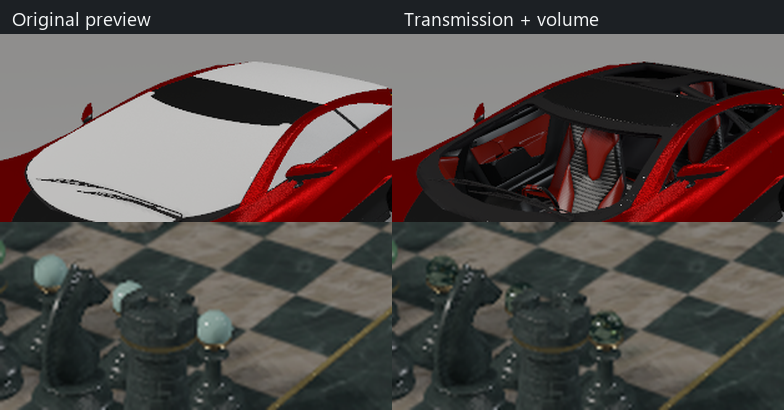
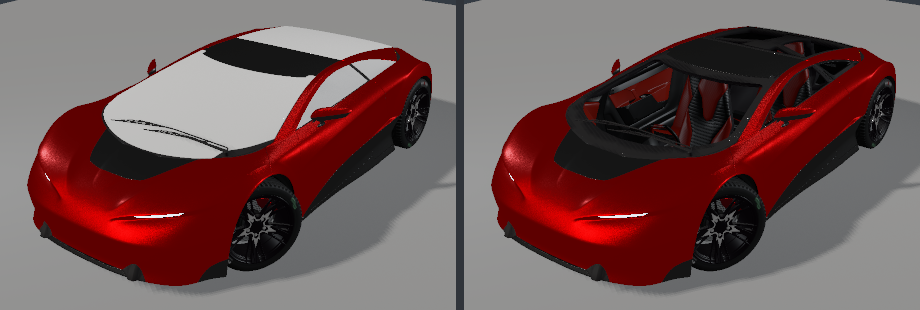
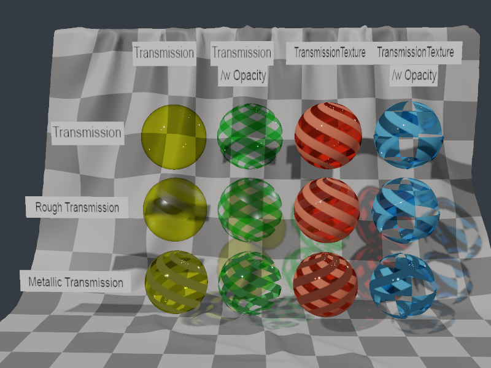
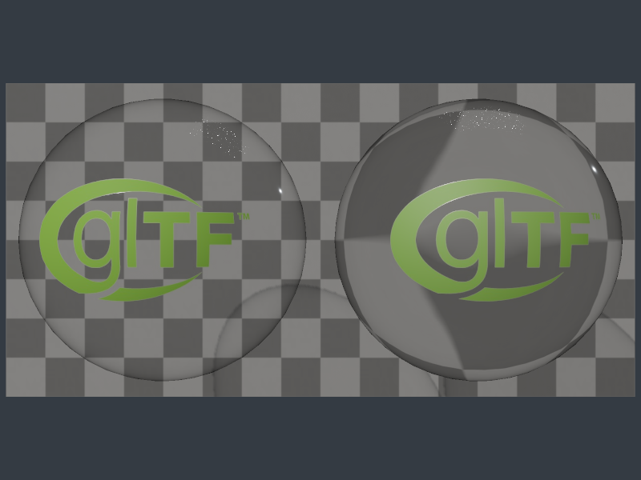
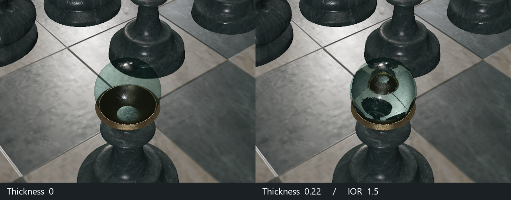

# 场景与使用示例

所有命令均在仓库根目录的 PowerShell 中运行。

## 1. 命令行速览

`formlight-renderer` 提供四种入口，像素坐标以图像左上角为 `(0, 0)`：

- `--inspect MODEL`：仅加载几何，统计网格数、实例数和实例化后的三角形总数。
- `--render MODEL`：直接加载 `.gltf` 或 `.glb` 模型，使用默认设置渲染。
- `--scene SCENE.toml`：按 TOML 配置文件渲染场景。
- `--preset many_balls|final_scene`：运行内置程序化路径追踪场景。

后三种入口必须搭配一种输出动作：`--output IMAGE.png`（写出 PNG）或 `--pixel X Y`（打印该像素的详细诊断报告）。常用覆盖参数包括 `--mode`、`--ssaa`、`--light-samples`、`--path-samples`、`--batch-size`、`--max-bounces`、`--bounce-sampling`、`--seed`、`--scene-seed`、`--defocus-angle`、`--focus-distance`。

```powershell
$cli = ".\build\release\formlight-renderer.exe"
& $cli --inspect assets/BoxTextured.glb
& $cli --render assets/BoxTextured.glb --output build/release/box.png
& $cli --scene scenes/lighting/box-two-lights.toml --pixel 320 240
```

交互窗口则通过 TOML 启动：

```powershell
.\build\release\formlight-viewer.exe --scene scenes/path/final-scene.toml
```

## 2. 按观察目标选场景

如果要连续预览多个外部 glTF/GLB 模型，可直接用[通用模型预览](../scenes/lighting/model-preview.toml)启动交互窗口：

```powershell
.\build\release\formlight-viewer.exe --scene scenes/lighting/model-preview.toml
```

- 默认以镂空板起步（地面亮孔方便核对 alpha 阈值与投影），使用 `800×600`、`2×2 SSAA` 与 Reinhard 映射；通过 **Open Model...** 切换模型时会自动取景。
- 灯组包含两盏方向光（侧前主灯开 3×3 PCF 阴影 + 背面补光）与适度环境光；点光源和矩形灯使用世界坐标，遇到尺度差异较大的模型可单独微调灯位。
- 需要观察矩形灯软阴影时，切到 `hybrid` 模式、勾选矩形灯的 `shadows` 后点 **Apply**，并将 `light_samples` 从 `4` 提到 `16`。

| 观察目标 | 场景配置 | 建议对照方式 |
| --- | --- | --- |
| 硬阴影与软阴影 | [方向光](../scenes/lighting/box-directional.toml)、[矩形灯](../scenes/lighting/box-area-light.toml) | 同机位切换 `raster` 与 `hybrid` 对比方向光阴影；矩形灯用 `--pixel 85 310` 重放半影（[方盒实验](box-shadows.md)） |
| 灯色、衰减与多灯累加 | [暖色方向光](../scenes/lighting/box-warm-directional.toml)、[点光源](../scenes/lighting/box-point.toml)、[双灯](../scenes/lighting/box-two-lights.toml) | 在双灯场景中交替把一盏灯的 `enabled` 设为 `false`，核对单灯与总贡献 |
| 金属度、粗糙度与 AO | [材质球](../scenes/materials/material-spheres.toml)、[遮蔽面板](../scenes/materials/occlusion-panel.toml) | 材质球上排为金属、下排为非金属，从左到右粗糙度递增；AO 面板拾取 `(52, 128)` 可见遮蔽值 `0.78137` |
| 多套 UV、Mipmap 与法线贴图 | [双 UV](../scenes/materials/dual-uv-panel.toml)、[棋盘地板](../scenes/materials/mip-checker.toml)、[法线面板](../scenes/materials/normal-panels.toml) | 观察同图多绑定各自选 UV、远处斜面三线性过滤，以及手写切线与 MikkTSpace 切线对照 |
| 镂空、透明合成与自发光 | [MASK](../scenes/materials/mask-panel.toml)、[BLEND](../scenes/materials/blend-layers.toml)、[发光面板](../scenes/materials/emissive-panels.toml) | 发光面板用 `--mode path --pixel 200 160` 重放背光面，线性 RGB 为 `(0.25, 0.125, 0.0625)` |
| 同机位直接光 vs 间接光 | [色溢房间](../scenes/lighting/color-bleed-room.toml) | 白色矩形灯照亮红、绿侧墙，对比 `hybrid`、`path` 零反弹与三次反弹（[图与数据](rendering.md#4-同机位的直接光与间接光对照)） |
| 网格顶灯、玻璃折射与焦散 | [Cornell 漫反射](../scenes/path/cornell-diffuse.toml)、[网格玻璃球](../scenes/path/cornell-glass.toml)、[解析玻璃球](../scenes/path/cornell-analytic.toml) | 调整反弹深度或开关方向采样目标，观察色溢与球底焦散方差变化 |
| 薄透镜景深与快门运动模糊 | [Many Balls](../scenes/path/many-balls.toml)、[运动球](../scenes/path/moving-sphere.toml) | 固定场景布局，分别调节光圈角、对焦距离或快门区间 |
| 球面纹理与参与介质 | [地球](../scenes/path/earth.toml)、[大理石](../scenes/path/marble.toml)、[三维棋盘](../scenes/path/checker.toml)、[吸收球](../scenes/path/absorbing-sphere.toml)、[散射介质](../scenes/path/scattering-media.toml) | 单项调节纹理或介质参数，再回到 [Final Scene](../scenes/path/final-scene.toml) 观察组合效果 |

## 3. 三组重点路径追踪实验

### 3.1 Cornell 房间：发光网格、玻璃与采样目标

- **间接光与色溢（`cornell-diffuse.toml`）**：顶灯是朝下发光的三角网格，必须经过反弹路径才能被白墙看到。`max_bounces = 1` 得到顶灯直接照亮的效果，增加深度后红、绿侧墙的色溢开始显现：
  ```powershell
  $cli = ".\build\release\formlight-renderer.exe"
  $room = "scenes/path/cornell-diffuse.toml"
  & $cli --scene $room --max-bounces 1 --path-samples 2048 --output build/release/cornell-direct.png
  & $cli --scene $room --max-bounces 3 --path-samples 2048 --output build/release/cornell-bounces.png
  ```
- **玻璃折射与方向采样目标（`cornell-glass.toml`）**：通过 `[[scene.path_materials]]` 将 glTF 材质 `4` 指定为 `type = "dielectric"`、`ior = 1.5`（改成 `type = "mirror"` 并去掉 `ior` 即可切换为理想镜面）。配置 `scene.sampling_targets = [1]` 把玻璃球加入方向采样后，漫反射路径的提议概率变为 **1/2 余弦半球、1/4 顶灯、1/4 玻璃球包围球**。在每种子 128 路径、64 个种子下的地面三探针对照中，球底红通道综合 RMS 误差由 `0.264` 降至 `0.232`，球外对照点则由 `0.028` 升至 `0.045`。[光学回归](../tests/path_specular_test.cpp) · [焦散对照](../tests/cornell_caustic_test.cpp)
- **网格球 vs 解析球（`cornell-analytic.toml`）**：使用 `[[scene.spheres]]` 在世界坐标中放置解析玻璃球并启用 `sampling_target = true`。在像素 `(46, 96)` 对比，解析球视深为 `3.32187887`，网格球为 `3.32302275`。如果需要与 `hybrid` 做逐样本直接光核对，请使用带显式矩形灯的 `color-bleed-room.toml`。[球体求交](../tests/sphere_query_test.cpp)

### 3.2 Many Balls 与物理相机（景深、运动模糊）

- **场景布局**：默认 `--scene-seed 42` 生成 480 个静止小球（其中 73 个模糊金属球的 `fuzz` 上限由 `metal_fuzz_max` 控制，默认 `0.5`）、3 个主角大球（中玻璃、左漫反射、右理想镜面）和 1 个地面大球，共 484 个解析球。默认输出 `256×144`、每像素 32 条路径、最大 8 次反弹、环境色 `(0.7, 0.8, 1)`。[布局与环境光](../tests/many_balls_test.cpp)
- **薄透镜景深**：默认光圈角 `0.6°`，对焦距离 `focus_distance = 10`（沿相机前向轴量至焦平面）。对比针孔与薄透镜：
  ```powershell
  .\build\release\formlight-renderer.exe --preset many_balls --defocus-angle 0 --output build/release/pinhole.png
  .\build\release\formlight-renderer.exe --preset many_balls --focus-distance 10 --defocus-angle 0.6 --output build/release/thin-lens.png
  ```
  [薄透镜回归](../tests/thin_lens_test.cpp)
- **快门运动模糊**：在 [moving-sphere.toml](../scenes/path/moving-sphere.toml) 中，`center` 为归一化时间 `0` 的球心，`displacement` 为时间 `0 → 1` 的总位移，`shutter_open` / `shutter_close` 决定曝光区间（两端同设为 `0.5` 即冻结在快门中点）。交互窗口的 **Lens** 与 **Shutter** 面板可直接调整这些参数。[运动模糊回归](../tests/motion_blur_test.cpp)

### 3.3 Final Scene 与独立材质/介质示例

- **构图与几何**：相机从 `(478, 278, -600)` 看向 `(278, 278, 0)`，垂直视场 `40°`，快门 `[0, 1]`。顶灯由两片朝下发光三角形构成，线性辐亮度 `(7, 7, 7)`。400 个底面 `100×100`、高度随机在 `[1, 101)` 的地块共享同一闭合立方体网格；千球群在独立随机流中生成于 `165³` 立方体内，绕 Y 轴旋转 `15°` 后平移至 `(-100, 270, 395)`。[地块回归](../tests/final_ground_test.cpp) · [球群回归](../tests/final_cluster_test.cpp)
- **采样与分批**：默认输出 `192×192`、每像素 128 条路径、最多 16 次反弹（首页展示图为 `320×320`、`ssaa = 2`、每子像素 512 路径、24 次反弹；窗口截图为默认预览）。可通过 `--batch-size` 将离线渲染拆成多批累积，结果与单批逐像素一致：
  ```powershell
  .\build\release\formlight-renderer.exe --preset final_scene --batch-size 19 --output build/release/final-scene-batches.png
  ```
  [完整场景回归](../tests/final_scene_test.cpp) · [分批累积回归](../tests/path_frame_test.cpp)

| 独立示例 | 关键参数与现象 |
| --- | --- |
| **地球**（`earth.toml`） | `albedo_texture` 支持 PNG/JPEG，sRGB 解码后在线性空间双线性过滤，再乘 `albedo`。经度接合在 `-X` 方向，U 循环、V 钳制，北极在图像首行。旧 Rust 示例用最近邻且未做 sRGB 解码，跨版本对图时需留意此差异。[UV 回归](../tests/sphere_texture_test.cpp) |
| **大理石**（`marble.toml`） | `marble = { scale = 0.2, seed = 42 }`。7 层 Perlin 噪声每层频率加倍、权重减半，求和取绝对值得到 `turbulence`，条纹调制为 `0.5 * (1 + sin(scale * p.z + 10 * turbulence(p)))`。[实现](../src/path/perlin.cppm) |
| **三维棋盘**（`checker.toml`） | `checker.cell_size` 为世界单位格子边长，按三轴格子编号之和的奇偶取线性色 `even` / `odd`。棋盘与大理石均在球体参考姿势下求值，花纹随运动球同步移动。[边界回归](../tests/checker_test.cpp) |
| **吸收球**（`absorbing-sphere.toml`） | `[[scene.media]]` 用球体限定介质边界。中心射线穿过半径 `1`、`extinction = 0.5` 的纯吸收球后，背景透过率为 $\exp(-0.5 \times 2) \approx 36.8\%$。[介质回归](../tests/medium_test.cpp) |
| **散射介质**（`scattering-media.toml`） | `scattering_albedo` 控制各通道散射权重（全零退化为纯吸收）。Final Scene 中半径 `70` 的蓝色局部介质与半径 `5000`、`extinction = 0.0001` 的全局白雾共存；折射由玻璃表面处理，自由程由介质处理。 |

## 4. TOML 配置约定

- **分区与覆盖顺序**：`[scene]` 选资产或预设，`[camera]` 定机位与透镜/快门，`[render]` 控制模式、画幅与采样，`[lighting]` 配环境项与直接光源，`[display]` 配曝光与色调映射。优先级固定为：**内置默认值 / 预设 → TOML 文件 → 显式 CLI 参数**。若 TOML 中自定义了 `scene.spheres` 或 `scene.media`，会整体替换预设的对应列表。[配置定义](../src/config/scene_config.cppm)
- **相对路径规则**：`scene.asset` 与解析球的 `albedo_texture` 相对于 TOML 所在目录；多文件 `.gltf` 内的 buffer 与图片 URI 相对于 `.gltf` 文件。Viewer 执行 **Save Scene As** 时会自动重算相对路径。
- **灯光模式分工**：`[lighting].ambient` 与 `[[lighting.lights]]` 服务于光栅和混合模式（省略整组 `[lighting]` 时显示无光照底色预览）。方向光在 `raster` 下可启用 `pcf = true`；带阴影的点光和矩形灯需在 `hybrid` 下做射线遮挡。路径模式的受光机制见[渲染方程与采样](rendering.md#1-表面的渲染方程与三种模式)。
- **采样与种子分离**：`ssaa` 取 `1` 或 `2`（每轴主样本数）；`light_samples` 是单次矩形灯的灯面样本数；`path_samples` 是每个 SSAA 子像素的路径数。`--scene-seed` 控制程序化布局，`--seed` 控制渲染随机流，便于单独复现或替换其中之一。

## 5. glTF 导入与材质约定

- **几何与切线**（[网格导入](../src/io/gltf/mesh.cppm)）：
  - 支持 `TRIANGLES`、`TRIANGLE_STRIP` 与 `TRIANGLE_FAN`，导入时统一展开为三角形列表。
  - 当前导入静态网格。带蒙皮的网格节点或带 morph target 的图元会在加载时报错，即使模型只用固定权重变形。
  - 缺少 `NORMAL` 属性时，加载器按相邻三角形面积加权生成平滑顶点法线（注意：glTF 2.0 规范对此约定逐面平面法线，共享顶点的折面外观会略有不同，见 [glTF 几何规范](https://registry.khronos.org/glTF/specs/2.0/glTF-2.0.html#meshes-overview)）。
  - 法线贴图优先使用自带 `TANGENT`；缺失时按法线贴图所选 UV 集自动生成 MikkTSpace 切线。
- **纹理与可见性**（[纹理变换](../src/io/gltf/texture_transform.cppm) · [纹理过滤](../src/texture.cppm) · [材质可见性](../src/io/gltf.cpp)）：
  - 每个贴图槽独立选择 `TEXCOORD_0` / `TEXCOORD_1`、采样器与 `KHR_texture_transform`（按缩放 → 旋转 → 平移顺序变换坐标）。
  - 底色与自发光按 sRGB 解码到线性空间；金属度、粗糙度、AO 与法线贴图保持线性读取（法线 Mipmap 降采样后自动重新单位化）。
  - 光栅片元用精确解析屏幕导数选择 Mip 层级；当前路径命中固定采样第 0 层。
  - `OPAQUE` 和通过阈值的 `MASK` 参与主可见性。光栅与混合模式在最近的不透光表面之前逐像素排序，合成透射和 `BLEND` 层。`doubleSided` 同时作用于相机与投影面。体积边界按正面入射计算一次烘焙厚度。

## 6. glTF 模型展示与透射验收

### 六模型同机位验收

首页六模型拼图均基于[通用模型预览](../scenes/lighting/model-preview.toml)（自动取景、地面、`800×600`、`2×2 SSAA`、种子 `7`、Reinhard；拼图仅对最终帧裁切、缩放并加标题）。将同一配置分别在接入透射前的 `8b1aaf9` 与完成厚玻璃后的 `97c592b` 上渲染，统计整幅 RGB8 发生变化的像素数：

| 模型 | 变化像素 / 480,000 | 原画幅观察点 |
| --- | ---: | --- |
| **Car Concept** | `18,848` | 挡风玻璃 `(395, 275)` 由 RGB8 `(190, 189, 188)` 变为透出红色座椅的 `(114, 35, 29)`；雨刷 `(314, 306)` 两次均为 `(23, 22, 22)` |
| **A Beautiful Game** | `2,707` | 黑兵球顶 `(452, 370)` 由 `(127, 150, 143)` 变为 `(35, 40, 28)`；仍拾取到球顶，4 个子样本向下折射偏移 `2.30～5.16` 像素读取背景 |
| **其余四个模型**（Plant / Rusty Car / CCity / Damaged Helmet） | 每张 `0` | 逐像素完全复现（植物叶背漫透射与萤火虫动画留待下一阶段） |



重放方法：用 Viewer 打开 `model-preview.toml`，经 **Open Model** 加载对应 GLB 并用 **Save Scene As** 保存为 `build/car.toml` 或 `build/chess.toml`，随后用 CLI 检查（CLI 输出线性 RGB，上表为 PNG 的 RGB8）。[模型来源与许可](../assets/README.md#gallery-image-credits)

```powershell
$cli = ".\build\release\formlight-renderer.exe"
& $cli --scene build/car.toml --pixel 395 275
& $cli --scene build/chess.toml --pixel 452 370
& $cli --scene build/chess.toml --output build/chess.png
```

### 光滑薄玻璃

`raster` 与 `hybrid` 支持 `KHR_materials_transmission`（要求该扩展的模型需在这两种模式下预览；`path` 的玻璃仍由路径材质表单独指定）。当粗糙度为 `0` 时，玻璃沿同一相机子样本读取后方线性颜色，按底色、非金属份额与 Fresnel 透射叠加表面直接照明和自发光。



- 在通用预览自动取景下拾取 Car Concept 的 `(395, 275)`，会命中挡风玻璃，显示 **glTF transmission** 为 `1` 且 **Transmitted background** 给出座椅传入的线性 RGB；拾取 `(314, 306)` 的 4 个子样本全部命中雨刷。
- 模型与纹理由 Eric Chadwick 制作，© 2024 Darmstadt Graphics Group GmbH。[模型与标识署名](https://github.com/KhronosGroup/glTF-Sample-Assets/tree/main/Models/CarConcept#legal) · [CC BY 4.0](https://creativecommons.org/licenses/by/4.0/)

### 磨砂玻璃与彩色投影

**TransmissionTest** 的三行依次展示光滑透射、粗糙透射与带金属度的透射材质；四列从左到右依次为均匀透射、均匀透射 + 覆盖遮罩、透射贴图、透射贴图 + 覆盖遮罩。最右列开孔直接露出背景、蓝色材质继续透光，幕布上的彩色投影也能清晰区分两种区域（模型由 Adobe 提供，CC0 许可，[模型说明](https://github.com/KhronosGroup/glTF-Sample-Assets/tree/main/Models/TransmissionTest)）。



- **重拍参数**：沿用通用预览灯组并设 `scene.ground = false`，将 `[camera]` 替换为以下参数以复现资产自带的 `render_camera`：
  ```toml
  [camera]
  auto_frame = false
  position = [-0.07675539702177048, 0.3394200801849365, 1.802846074104309]
  target = [-0.11526571024334285, 0.19903196081899857, 0.813498748018537]
  up = [-0.0054605596134611745, 0.990096548758427, -0.14028188175178194]
  vertical_fov_degrees = 34.515876027228366
  ```
- **独立夹具验证**：[条纹夹具](../tests/fixtures/frosted-stripes.gltf) 单独验证磨砂滤波与彩色投影；`blend_layers` 回归核对双层重叠玻璃的投影衰减以及磨砂条纹的整图与拾取一致性。

### 两个 glTF 标志球

**CompareIor** 将两个共用透射贴图的球置于棋盘格前方：左球为默认 IOR `1.5` 与零厚度薄壳，棋盘格保持原尺度；右球指定厚度 `1` 与 IOR `2.42`，折射位移使棋盘格在球内明显放大。[模型与标志署名](../assets/README.md#gallery-image-credits)



- **重拍与拾取**：沿用通用预览灯组与画幅，设 `scene.ground = false`、`camera.auto_frame = false`、`position = [0, 0, 3]`、`target = [0, 0, 0]`、`up = [0, 1, 0]`、`vertical_fov_degrees = 32`。拾取右球 `(580, 187)` 可读到透射率约 `0.996`、IOR `2.42`、网格厚度 `1`。

### 棋兵的厚玻璃

固定 IOR `1.5` 单独观察厚度影响：左图将厚度置零，球顶左上方的棋盘格边线笔直穿过；右图恢复黑棋兵材质原始厚度 `0.22`，边线向内弯折、金色底座随之偏移。青绿色来自界面底色（模型未设置衰减距离，不产生体积吸收）。



- **拾取与重拍**：通用预览打开 A Beautiful Game 后拾取 `(452, 370)` 可读到 IOR `1.5`、网格厚度 `0.22`。重拍近景时关闭主灯阴影，将画幅设为 `560×400`，关闭自动取景，并配置：
  ```toml
  [camera]
  auto_frame = false
  position = [0.03467629620603227, 0.16932758928835392, 0.009571823175870894]
  target = [-0.03132370379396773, 0.07032758928835392, 0.0935718231758709]
  vertical_fov_degrees = 23
  ```
- **体积吸收回归**：运行 `ctest --preset release-local -R blend_layers --output-on-failure` 可单独验证[玻璃板夹具](../tests/fixtures/volume-slab.gltf)（IOR `2`、线性 G 通道厚度贴图、非均匀缩放与有限衰减距离）的正入射 RGB、背景横向位移及整图/拾取一致性。[折射与吸收公式](rendering.md#gltf-玻璃的透射与折射)
- 原始模型由 MaterialX Project 制作（© 2020 ASWF），Ed Mackey 于 2022 年转换为 glTF。[模型与署名](https://github.com/KhronosGroup/glTF-Sample-Assets/tree/main/Models/ABeautifulGame#legal) · [CC BY 4.0](https://creativecommons.org/licenses/by/4.0/)
